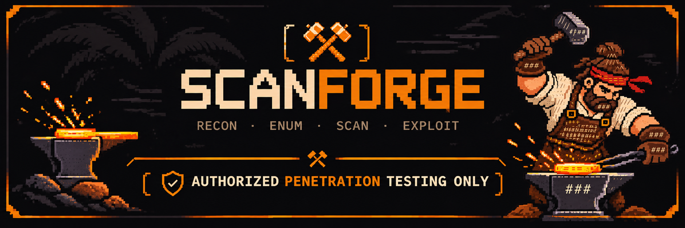
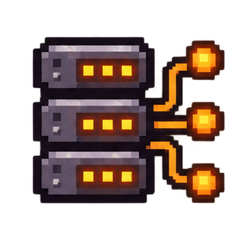
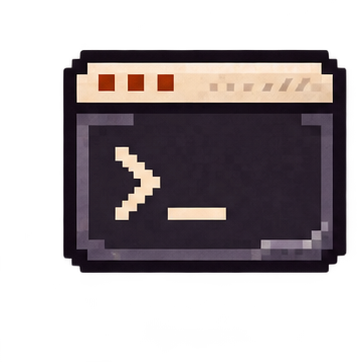
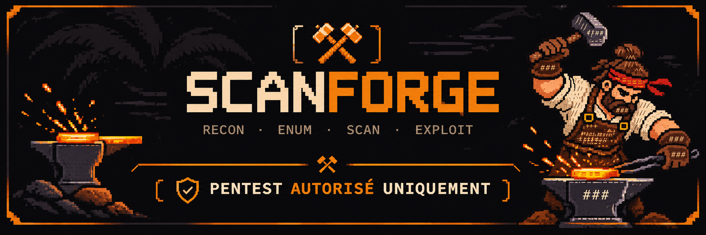

<p align="center">
  
</p>

# ScanForge

**ScanForge** is a command-line tool (CLI) written in Go, designed to securely and structurally orchestrate your penetration testing and reconnaissance (recon) workflows.

Thanks to its artifact-driven architecture, ScanForge chains well-known security tools while enforcing extremely strict scope validation rules to prevent any unauthorized scanning.


##  Documentation

- [Usage guide](docs/USAGE.md): installation, configuration, commands and examples.
- [Scope management](docs/SCOPE.md): implicit modes, files, exclusions and CI.
- [Architecture](docs/ARCHITECTURE.md): DAG, artifacts, central filtering and outputs.
- [Resume & checkpoints](docs/RESUME.md): interrupt and resume runs (French).
- [Incremental scans](docs/INCREMENTAL.md): asset history and `--incremental` (French).
- [Recursive discovery](docs/RECURSIVE.md): `--recursive` (French).
- [Workflows](docs/WORKFLOWS.md): YAML workflows (French).
- [MCP server](docs/MCP.md) and [local API](docs/API.md): drive ScanForge from agents (French).
- [Contribution guide](AGENTS.md): repository structure, style and validations.

> **Français** : [Documentation en français](docs/fr/README.md) · **中文**：[中文文档](docs/zh/README.md)

##  Key Features

- **Artifact-driven pipeline**: Modules communicate through artifacts in an ordered way (e.g. `subfinder` output automatically feeds `dnsx` and `httpx`), and each independent branch advances as soon as its inputs are ready.
- **Strict scope validation**: Explicit scope via file, or confirmed implicit scope (`domain` by default for DNS domains; `exact` for IPs or on request), then filtering of every artifact.
- **Multi-target engagements**: `--targets file` runs a profile against many targets (one per line, comments and blanks ignored); each target gets its own scope validation, run directory and report, and a failing target does not abort the rest.
- **Interactive wizard**: a bare `scanforge run` on a terminal asks for the missing target and profile instead of failing.
- **Proxy integration (Caido / Burp Suite)**: `--proxy` routes HTTP traffic of the relevant modules through your interception proxy for manual triage/replay.
- **Authenticated scanning**: `-H/--header` (repeatable) injects headers/cookies (session, bearer token) into every HTTP request issued.
- **JavaScript secrets scanner**: the `jssecrets` module fetches crawled `.js` files (plus JS-looking URLs surfaced by `gau`'s historical URLs and `ffuf`'s fuzzed paths) and detects exposed API keys/tokens/creds — including Anthropic, OpenAI (current and legacy), xAI, Groq, OpenRouter and Perplexity key formats, AWS access/session tokens, Cloudinary URLs, Postman API keys and Basic-Auth headers — public cloud buckets, internal hosts, emails, sensitive API endpoints and accessible source maps; the `jsverify` module then replays the generated PoC payloads in a headless browser and reports executed, sink-reached, not-observed or unreachable verdicts.
- **Backend-as-a-service detection**: the `dbdetect` module passively fingerprints Supabase/Firebase/Appwrite/PocketBase backends from the target's own crawled pages and JS (never contacting them), then scopes the discovered backend host; `dbenum` performs bounded, read-only enumeration of that backend (table/collection listing, row counts, permission checks) without ever reading row contents.
- **WAF-aware scanning**: when `wafw00f` reports a WAF, `ffuf`, `nuclei` and `katana` automatically back off — lower concurrency/rate-limit, randomized request delay, and User-Agent rotation — unless you already set an explicit rate limit or `User-Agent` header yourself.
- **Visual snapshots**: the `screenshot` module captures screenshots of alive URLs via `httpx`, listed in the report.
- **Benchmark suite**: `scanforge benchmark` runs the real pipeline against bundled intentionally-vulnerable lab targets (Firing Range, testphp.vulnweb.com, Juice Shop demo, local DVWA) and scores detection against documented expectations — a maintainer/CI tool, not part of a client engagement.
- **WordPress parity mode**: `--preset wp` (or `--wp` on any profile) chains wpdetect (multi-signal core version), wpplugins/wpthemes (passive or aggressive enumeration), wpusers (author + REST API), wpexposure (wp-config backups, debug.log, listings), wpxmlrpc (methods/multicall/pingback) and wpcve (advisory correlation) — the same surface wpscan covers, without new external tools. `wpbrute` is opt-in strict (off by default everywhere).
- **Tech-to-CVE correlation**: `techcve` matches detected technologies and versions against a small bundled dataset and, after `scanforge intel update`, against a local NVD/CISA KEV/EPSS cache. A match is only reported as confirmed when the version falls in an affected CPE range; name-only similarity stays an unconfirmed lead.
- **Resume & checkpoints**: `scanforge resume <run-id>` continues an interrupted run, skipping modules already completed with identical inputs; `status` and `runs list` inspect runs. File-based, no database.
- **YAML workflows**: `--workflow file.yaml` defines steps, dependencies, timeouts, retries and error policy; validated before execution, no arbitrary shell, same scope enforcement.
- **Resource limits**: `--concurrency`, `--rps`, `--max-requests` and `--command-timeout` (or `limits:` in the config) cap how hard a run hits targets.
- **Discovery events (experimental)**: `--events` emits scope-gated discovery events (e.g. subdomains as `DNS_NAME`) to `00_meta/events.jsonl`.
- **Incremental scans**: `--incremental` compares the run to a per-target asset history (`runs/<target>/assets.jsonl`) so nuclei, ffuf, katana and jssecrets only look at new or changed URLs; `scanforge assets <target> [--new|--gone]` lists the history.
- **Recursive discovery (opt-in)**: `--recursive` (with `--recursive-depth` / `--recursive-budget`) follows new in-scope names and URLs found late (JS, crawl) with bounded dnsx/httpx/katana passes; out-of-scope discoveries are dropped and logged.
- **Non-standard web ports**: in `deep`/`full`, `httpx` also probes the scope-filtered `host:port` targets found by `naabu` (8080, 8443, 3000...).
- **Agent access (MCP + API)**: `scanforge mcp` and `scanforge api` expose runs, assets, findings and evidence. Active scans are off by default and require `--allow-active` plus a strict scope file; every active call is audited.
- **Fully configurable Nuclei**: severity, tags, rate-limit, overall timeout, custom templates and template updates via dedicated flags.
- **Parallelized Nmap**: bounded worker pool (`--nmap-concurrency`) instead of sequential host-by-host scans.
- **Live console**: the scan streams a chronological, tagged event log (no fullscreen interface) — pipeline phases, module lifecycle, findings printed the moment they are discovered (with the exposed email, secret or host), a volatile progress line on interactive terminals (a generated pixel-art hammer/anvil loop, 16 columns by 6 rows with status alongside; a single-line spinner below 50 columns by default; `SCANFORGE_SPINNER=forge|dots|off` changes it), expanded severity blocks for high/critical findings, deduplicated repeats counted in a `Finding types` recap, and a final `── SCAN COMPLETE ──` summary. Output stays grep/tee/CI friendly; `-v/-vv/-vvv` raise verbosity, `-q` silences everything but findings, errors and the summary.
- **Webhook notifications**: at the end of each run, a summary is posted to a Slack/Discord/Teams webhook configured in `scanforge.yaml`.
- **Run comparison & export**: `scanforge diff` lists what changed between two runs of the same target (assets, ports, vulnerabilities); `scanforge export` serializes a run as SARIF 2.1.0 (GitHub/GitLab code scanning) or DefectDojo generic findings.
- **Dry-Run mode**: Preview the commands that will be launched and the generated files before making any network request.
- **Diagnostic tool (Doctor)**: Instantly check whether your local dependencies are installed and configured for the selected profile.
- **Consolidated reports**: Automatically generates a unified risk model in `report.json` and `report.md` formats.

---

##  Supported Tools

ScanForge centralizes and orchestrates **14 external security tools** and **16 native modules**:

External tools:

1. **subfinder** (Subdomain discovery)
2. **shuffledns** (DNS bruteforce, module `dnsbrute`; results merged into `dnsx`)
3. **dnsx** (Active DNS resolution)
4. **httpx** (HTTP probing, technology detection and screenshots)
5. **naabu** (Ultra-fast port scanner)
6. **nmap** (Accurate port scanning and service detection, run in parallel)
7. **whatweb** (Web technology fingerprinting)
8. **wafw00f** (Web Application Firewall detection)
9. **katana** (Web resource crawling)
10. **ffuf** (Directory and file fuzzing)
11. **nuclei** (Template-based vulnerability scanner)
12. **gau** (Passive collection of historical URLs)
13. **tlsx** (TLS certificate and protocol enrichment)
14. **chromium** (Headless browser used by the `jsverify` module)

Native modules (no external binary):

- **ctlogs** — passive subdomain discovery from Certificate Transparency logs (crt.sh) with timeouts, size cap, retries/backoff and `--proxy` support; names flow through the normal scope filter (out-of-scope names are logged to `scope-rejections.jsonl`, never auto-allowed) and are resolved by `dnsx`
- **asnmap** — RDAP network attribution (IANA bootstrap, rdap.org fallback) of in-scope resolved IPs: network range, name, organisation, country, registry handle (and the ASN when `dnsx` or RDAP provides it), shown in `report.md`/`report.json`; annotation only, it never adds CIDRs or neighbouring IPs to the scope or produces scan targets
- **jssecrets** — analyzes JS crawled by `katana` (plus JS URLs from `gau`/`ffuf`) to detect secrets (including AI-provider API keys), cloud buckets, internal hosts, emails and exposed source maps; reports `partial` when every fetch fails instead of a false-clean `completed`
- **jsverify** — replays `jssecrets` PoC payloads in a headless browser (payload injected via URL parameters, fragment and `postMessage`) and reports executed, sink-reached, not-observed or unreachable verdicts; reports `partial` when the browser is unavailable, fails to launch, or every replay is unreachable
- **dbdetect** — passively fingerprints Supabase/Firebase/Appwrite/PocketBase backends from already-crawled pages/JS and auto-scopes the discovered backend host
- **dbenum** — active, read-only enumeration of a `dbdetect`-discovered backend (table/collection listing, row counts, permission checks); never reads row/document contents
- **attacksurface** — consolidates alive hosts, crawled URLs, fuzzed paths and JS-discovered endpoints into one attack surface list for downstream scanners
- **techcve** — correlates detected technologies and versions with known CVEs from a bundled dataset (real CVSS base scores from NVD)
- **httpcheck** — checks HTTP security headers (CSP, HSTS, clickjacking, cookies) on the discovered attack surface; reports `partial` when every probed URL was unreachable
- **payloadgen** — generates contextual wordlists (API paths, parameters, per-technology endpoints) from scan findings
- **wpdetect** — multi-signal WordPress detection and core version fingerprinting (generator, RSS, readme.html, REST index)
- **wpplugins** / **wpthemes** — enumerate installed plugins/themes passively (crawled assets, `?ver=`) or actively (`readme.txt`/`style.css`, bundled top lists, `--wp-detection-mode`/`--wp-wordlist`)
- **wpusers** — enumerate WordPress users via `?author=N` redirects and the REST `/wp/v2/users` endpoint
- **wpexposure** — checks wp-config backups, debug.log, default setup pages, directory listings, `.git`/`.env` exposure
- **wpxmlrpc** — probes XML-RPC: enabled state, method list, multicall and pingback availability
- **wpcve** — correlates WordPress core/plugin/theme versions with the bundled advisory dataset (offline)
- **wpbrute** — opt-in credential probe for enumerated users (`--wp-bruteforce` + `--confirm-scope` + `--wp-passwords`; off by default)

`httpx`, `nuclei`, `katana`, `ffuf`, `whatweb`, `wafw00f`, `subfinder`, `gau`, `jssecrets`, `jsverify`, `httpcheck`, `dbdetect`, `dbenum` and `screenshot` support `--proxy` and `-H/--header` to route traffic through Caido/Burp and scan in authenticated mode.

---

##  Simple Installation (Hassle-Free)

Like mainstream tools (nuclei, subfinder...), ScanForge is distributed as **prebuilt binaries** via GitHub Releases: no compilation, no Go required.

### Option 1: One-liner (Recommended)

**Linux / macOS / Git-Bash:**

```bash
curl -fsSL https://raw.githubusercontent.com/MikeRoss27/scanforge/main/install.sh | bash
```

The script detects your OS/architecture, downloads the latest version, verifies its SHA-256 checksum and installs it in `~/.local/bin`.

**Windows (PowerShell):**

```powershell
Invoke-Expression (Invoke-RestMethod https://raw.githubusercontent.com/MikeRoss27/scanforge/main/install.ps1)
```

The installer places the binary in `%LOCALAPPDATA%\Programs\scanforge` and automatically adds the directory to the user PATH.

**Specific version or custom directory:**

```bash
curl -fsSL https://raw.githubusercontent.com/MikeRoss27/scanforge/main/install.sh | bash -s -- --version v0.1.0 --dir /usr/local/bin
```

### Option 2: Full installation (binary + scan tools)

ScanForge orchestrates external tools (nmap, nuclei, subfinder, httpx, ...). `--full` installs dependencies that have a reliable unattended method (a recent Go remains required on Debian/Ubuntu and Windows):

```bash
curl -fsSL https://raw.githubusercontent.com/MikeRoss27/scanforge/main/install.sh | bash -s -- --full
```

From a clone of the repository, the local scripts do the same:

```bash
chmod +x install.sh && ./install.sh --full   # Linux / macOS
.\install.ps1 -Full                           # Windows (PowerShell)
```

- Arch uses only official pacman packages (`nmap`, `chromium`, `go`, `python-pipx`, `base-devel`) and never runs `pacman -Syu`. Pinned Go tools use `go install`, `wafw00f` uses pipx, and verified upstream artifacts provide massdns and the DNS wordlist. WhatWeb remains manual/AUR-only; no AUR helper is assumed.
- Debian/Ubuntu installs packages available in the current apt release, builds verified massdns when needed, and never modifies system Python with global pip.
- macOS uses Homebrew, pinned Go tools and pipx; WhatWeb and a Chrome-family browser may remain manual.
- Native Windows installs pinned Go tools and uses pipx when available. Nmap, massdns and WhatWeb remain manual; WSL or Docker is recommended for profiles that need them.

The final verification reports anything still missing. `scanforge doctor --profile NAME` then gives profile-specific status and installation guidance.

### Option 3: Docker (Zero local installation)

If you don't want to install Go or the other tools on your host system, use Docker. Runtime tools, massdns, Chromium and a verified pinned DNS wordlist are included.

```bash
# With docker-compose
docker-compose run scanforge run target.com --profile web

# Manually with Docker
docker build -t scanforge .
docker run -v $(pwd):/workspace scanforge run target.com --profile web
```

---

##  Build from source (development)

From a clone of the repository, the `Makefile` wraps the Go toolchain:

```bash
make build      # build ./scanforge with version ldflags
make install    # same, installed in $GOPATH/bin
```

Handy development targets:

| Command | Purpose |
| --- | --- |
| `make dev` / `make run` | Run the CLI via `go run` without building; pass arguments with `ARGS="plan example.com --preset deep"` |
| `make test` / `make race` | Test suite (fast / with the race detector) |
| `make check` | Pre-push gate: formatting check, `go vet`, golangci-lint and tests |
| `make cover` | Tests with coverage report and per-function summary |
| `make fmt` / `make fmt-check` | Format the code / list unformatted files without rewriting them |
| `make vet` / `make lint` | Static analysis; `make tools` installs the golangci-lint version pinned by CI |
| `make tidy` | Clean up `go.mod` / `go.sum` |
| `make clean` | Remove the binary and `coverage.out` |

---

##  Quick Start Guide

### 1. Initialize the project

Generate the default configuration files in your current directory:

```bash
scanforge init
```

This creates:

- `scanforge.yaml`: Lets you configure tool paths and modify/define profiles.
- `scope.txt`: Optional template to keep a reusable perimeter. You can delete it; ScanForge will then propose a minimal implicit scope to confirm.

### 2. Validate the environment

Check that all tools required for your scan profile are installed and accessible:

```bash
scanforge doctor --profile web
```

### 3. Launch a Scan

Without an applicable scope file, ScanForge includes the supplied DNS domain
and its subdomains, displays the scope and asks for confirmation before creating
the run. Discovered subdomains automatically feed DNSX, HTTPX and downstream
modules. IPs and single-label hosts keep an exact scope:

```bash
scanforge run example.com --profile web
```

On a terminal, a bare `scanforge run` (no target, no profile) opens an
interactive wizard that asks for both. Use `--scope-mode exact` to restrict
the run to the supplied host. To add rules or exclude hosts:

```bash
scanforge run example.com --scope-mode domain \
  --scope-add api.other.test --exclude admin.example.com
```

`--scope file.txt` remains authoritative and is never silently replaced if it
rejects the target. To avoid any ambiguity, it does not combine with
`--scope-mode`, `--scope-add` or `--exclude`. An explicit or configured file
requires no additional confirmation. For an implicit scope in CI or without a
TTY, inspect `scanforge plan` first, then confirm the intent with
`--confirm-scope`.

To test without sending any request:

```bash
scanforge run example.com --profile web --dry-run --confirm-scope
```

With an implicit scope, dry-run also requires confirmation: it performs no
network requests, but formalizes the authorized perimeter.

Preview the validated pipeline before creating a run:

```bash
scanforge plan example.com --preset deep
```

The `scanforge scan` command is a more direct alias of `scanforge run`:

```bash
scanforge scan example.com --preset safe
```

### 4. Multi-target engagements

`run` and `plan` accept a targets file instead of a single positional target:

```bash
scanforge plan --targets targets.txt --preset web
scanforge run --targets targets.txt --preset web --confirm-scope
```

The file holds one target per line (`#` comments and blank lines ignored).
`--targets` is exclusive with a positional target.

### 5. Compare runs and export findings

`scanforge diff` reconsolidates two run directories and lists what changed —
assets, ports and vulnerabilities that appeared or disappeared:

```bash
scanforge diff runs/example.com/2026-08-09_10-00-00 runs/example.com/2026-08-10_10-00-00
scanforge diff runs/example.com/2026-08-09_10-00-00 runs/example.com/2026-08-10_10-00-00 --json
```

`scanforge export` serializes the consolidated report for third-party tools:

```bash
scanforge export runs/example.com/2026-08-10_10-00-00 --format sarif          # GitHub/GitLab code scanning
scanforge export runs/example.com/2026-08-10_10-00-00 --format defectdojo     # import-scan "Generic Findings Import"
```

### 6. Resume, workflows and agent access

```bash
scanforge runs list
scanforge status example.com/2026-08-10_10-00-00
scanforge resume example.com/2026-08-10_10-00-00      # re-run only what changed or failed

scanforge workflow validate workflows/web-recon.yaml
scanforge run example.com --scope scope.txt --workflow workflows/web-recon.yaml

scanforge intel update                                # explicit network step: NVD, KEV, EPSS
scanforge mcp                                         # read-only MCP over stdio
scanforge mcp --allow-active --scope scope.txt        # also allow scope-bound active scans
```

Findings keep leaked secret values in full, since they are the evidence for a
report. Only your own credentials (API keys, auth headers/cookies) are masked in
API/MCP output.

### 7. API keys and updates

Some tools (subfinder, nuclei, ...) benefit from API keys. Manage them with
`scanforge auth`:

```bash
scanforge auth set shodan <API_KEY>
scanforge auth list
scanforge auth sync
```

Update the binary (and optionally the external tools) with `scanforge update`:

```bash
scanforge update            # binary only (requires Go)
scanforge update --tools    # binary + external tools
```

---

##  Proxy, authentication and Nuclei settings

For real-world penetration testing, route traffic through Caido (or Burp
Suite) and inject an authenticated session:

```bash
scanforge run app.example.com --profile web \
  --proxy http://127.0.0.1:8080 \
  -H "Cookie: session=..." \
  --nuclei-tags cve,exposure --nuclei-severity critical,high \
  --nuclei-update-templates \
  --nuclei-include-custom \
  --ffuf-wordlist /usr/share/wordlists/dirb/big.txt \
  --nmap-concurrency 6
```

- `--proxy`: HTTP/SOCKS proxy for the modules that speak HTTP.
- `-H/--header` (repeatable): raw header `"Name: Value"` added to every request.
- `--nuclei-severity`, `--nuclei-exclude-severity`, `--nuclei-tags`, `--nuclei-exclude-tags`, `--nuclei-rate-limit`, `--nuclei-templates`, `--nuclei-update-templates`: fine-grained control of the vulnerability scanner.
- `--nuclei-timeout`: overall time limit for a nuclei run, e.g. `45m` (default 30m; raise it for slow proxies or large target lists).
- `--nuclei-headless`: enable nuclei headless mode (browser-based templates).
- `--nuclei-include-custom`: also run the 40+ ScanForge templates bundled in `templates/` (cloud metadata endpoints, exposed admin panels and dashboards, CORS misconfigurations, XXE, SSRF, debug endpoints, ...); located via `SCANFORGE_TEMPLATES_DIR`, `./templates` or next to the binary.
- `--ffuf-wordlist`, `--ffuf-filter-codes`: override the ffuf wordlist (default `/usr/share/wordlists/dirb/common.txt`) and filter out status codes.
- `--nmap-concurrency`: number of simultaneous nmap scans (default 4); lower it to stay discreet on a sensitive engagement.

### Webhook notifications

Set `webhook.url` in `scanforge.yaml` to receive a run summary on Slack,
Discord or Teams at the end of every scan:

```yaml
webhook:
  url: https://example.com/hooks/your-webhook-url
```

The payload is a generic JSON document with a `text` field, so every major
webhook receiver renders a readable message (target, profile, status, assets,
ports, vulnerabilities by severity, run directory).

---

##  Built-in Profiles and Presets

| Name | Modules | Usage |
| --- | --- | --- |
| `safe` | subfinder, dnsx, httpx, tlsx | Light exposure check. |
| `recon` | subfinder, ctlogs, dnsbrute, gau, dnsx, asnmap, httpx, tlsx | Inventory enriched with historical URLs and DNS bruteforce. |
| `passive` | subfinder, ctlogs, dnsx, httpx | Minimal historical pipeline. |
| `ports` | subfinder, dnsx, naabu, nmap | Open ports then service validation. |
| `web` | subfinder, ctlogs, dnsbrute, dnsx, asnmap, httpx, whatweb, wafw00f, katana, jssecrets, dbdetect, dbenum, jsverify, attacksurface, techcve, httpcheck, payloadgen, screenshot, nuclei | Application analysis: attack-surface consolidation, JS secrets + headless verification, backend-as-a-service detection/enumeration, screenshots, tech-to-CVE correlation, header checks and payload generation. |
| `vuln` | subfinder, dnsbrute, dnsx, httpx, tlsx, katana, jssecrets, dbdetect, dbenum, attacksurface, techcve, nuclei | Targeted vulnerability detection (tech-to-CVE + templates). |
| `deep` | All modules | Full and noisy pipeline. |
| `full` | All modules | Full profile, history-compatible. |
| `wp` | subfinder, dnsbrute, dnsx, httpx, whatweb, wpdetect, wpplugins, wpthemes, wpusers, wpexposure, wpxmlrpc, wpcve, techcve, httpcheck, attacksurface, nuclei, screenshot | WordPress engagement: detection, plugin/theme enumeration, user mapping, exposure checks, XML-RPC and advisory correlation. `wordpress` is accepted as an alias. `--wp` injects the chain into any other profile. `wpbrute` is opt-in only (`--wp-bruteforce` + `--confirm-scope` + `--wp-passwords`). |

Use `--preset safe` or `--profile safe` interchangeably. Before any active
profile, always review its DAG with `scanforge plan`.

---

##  Final Report Structure

At the end of each scan, a timestamped folder is created under `./runs/`. In addition to the raw logs of each tool, ScanForge generates:

- `report.json`: Structured model of assets, ports, technologies and vulnerabilities.
- `report.md`: Readable synthetic report.
- `00_meta/manifest.json`: Run status, modules, artifacts and scope metadata.
- `00_meta/commands.log`: External commands prepared or executed.
- `00_meta/effective-scope.txt`: Canonical copy of the scope actually applied, with its source and mode recorded in the manifest.
- `00_meta/scope-rejections.jsonl`: Out-of-scope values rejected, when any.
- `01_subdomains/ct.txt`: Scope-filtered Certificate Transparency names (module `ctlogs`).
- `01_subdomains/asn_info.jsonl`: RDAP network attribution of in-scope resolved IPs, rendered in the report (module `asnmap`).
- `04_surface/attack-surface.txt`: Consolidated candidate URLs for scanning (module `attacksurface`).
- `04_payloads/`: Generated wordlists for api paths, endpoints, parameters and per-technology endpoints (module `payloadgen`).
- `04_web/screenshots/`: PNG snapshots of alive URLs (module `screenshot`).
- `06_vulns/js-secrets.jsonl`: Secrets, cloud buckets, internal hosts, emails and source maps detected in crawled JS (module `jssecrets`).
- `06_vulns/js-payloads.txt`: PoC payloads generated from the JS secrets (module `jssecrets`).
- `06_vulns/js-verified.jsonl`: Headless-browser verdicts (executed, sink-reached, not-observed) for the JS payloads (module `jsverify`).
- `06_vulns/cve-findings.jsonl`: Vulnerable versions correlated from fingerprints (module `techcve`).
- `06_vulns/http-checks.jsonl`: Missing security headers and cookie flags (module `httpcheck`).
- `06_vulns/nuclei.jsonl`: Raw nuclei findings (module `nuclei`).
- `06_vulns/db-fingerprint.jsonl`: Detected backend-as-a-service endpoints/keys (module `dbdetect`) and read-only enumeration results — table/collection lists, row counts, permission checks (module `dbenum`).

>  ScanForge must only be used on assets for which you have explicit
> authorization.

<p align="center">
  
</p>
