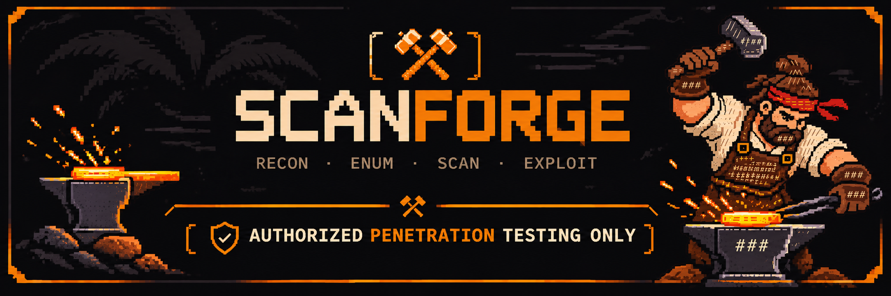
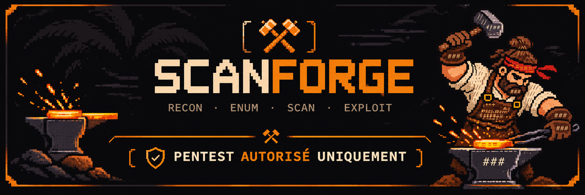

# README (Français)

<p align="center">
  
</p>

# ScanForge

> **English** : [English documentation](../../README.md) · **中文**：[中文文档](../zh/README.md)

**ScanForge** est un outil en ligne de commande (CLI) écrit en Go, conçu pour orchestrer de manière sécurisée et structurée vos flux de travail de test d'intrusion et de reconnaissance (recon).

Grâce à son architecture pilotée par les artefacts, ScanForge enchaîne intelligemment les outils de sécurité reconnus du marché tout en appliquant des règles de validation de scope extrêmement strictes pour éviter tout scan non autorisé.

<p align="center">
  
</p>

## 📚 Documentation

- [Guide d'utilisation](USAGE.md) : installation, configuration, commandes et exemples.
- [Gestion du scope](SCOPE.md) : modes implicites, fichiers, exclusions et CI.
- [Architecture](ARCHITECTURE.md) : DAG, artefacts, filtrage central et sorties.
- [Guide de contribution](../AGENTS.md) : structure du dépôt, style et validations.

## 🚀 Fonctionnalités Clés

- **Pipeline orienté Artefacts** : Les modules communiquent via des artefacts de manière ordonnée (ex : la sortie de `subfinder` alimente automatiquement `dnsx` et `httpx`) et chaque branche indépendante avance dès que ses entrées sont prêtes.
- **Validation de Scope Stricte** : Scope explicite par fichier ou scope implicite confirmé (`domain` par défaut pour les domaines DNS ; `exact` pour les IP ou sur demande), puis filtrage de chaque artefact.
- **Engagements multi-cibles** : `--targets fichier` exécute un profil contre de nombreuses cibles (une par ligne, commentaires et lignes vides ignorés) ; chaque cible obtient sa propre validation de scope, son répertoire de run et son rapport, et une cible en échec n'interrompt pas les autres.
- **Assistant interactif** : un simple `scanforge run` sur un terminal demande la cible et le profil manquants au lieu d'échouer.
- **Intégration proxy (Caido / Burp Suite)** : `--proxy` route le trafic HTTP des modules concernés à travers votre proxy d'interception pour triage/replay manuel.
- **Scan authentifié** : `-H/--header` (répétable) injecte des headers/cookies (session, bearer token) dans toutes les requêtes HTTP émises.
- **Scanner de secrets JavaScript** : le module `jssecrets` récupère les fichiers `.js` crawlés et détecte clés API/tokens/creds exposés, buckets cloud publics, hôtes internes, emails, endpoints API sensibles et source maps accessibles ; le module `jsverify` rejoue ensuite les payloads PoC générés dans un navigateur headless et rapporte des verdicts exécuté / sink atteint / non observé.
- **Captures d'écran visuelles** : le module `screenshot` capture des captures d'écran des URL vivantes via `httpx`, listées dans le rapport.
- **Mode parité WordPress** : `--preset wp` (ou `--wp` sur tout profil) enchaîne wpdetect (version core multi-signal), wpplugins/wpthemes (énumération passive ou agressive), wpusers (author + API REST), wpexposure (sauvegardes wp-config, debug.log, listings), wpxmlrpc (méthodes/multicall/pingback) et wpcve (corrélation d’advisories) — la même surface que wpscan, sans aucun nouvel outil externe. `wpbrute` en opt-in strict (désactivé par défaut partout).
- **Corrélation tech-to-CVE** : `techcve` croise les technologies et versions détectées avec un dataset embarqué aux scores CVSS réels issus de la NVD.
- **Nuclei entièrement paramétrable** : sévérité, tags, rate-limit, timeout global, templates personnalisés et mise à jour des templates via des flags dédiés.
- **Nmap parallélisé** : pool de workers borné (`--nmap-concurrency`) au lieu d'un scan séquentiel hôte par hôte.
- **Console de scan** : le scan diffuse un journal d'événements chronologique et tagué (pas d'interface plein écran) — phases du pipeline, cycle de vie des modules, findings affichés dès leur découverte (avec l'email, le secret ou l'hôte exposé), ligne de progression volatile sur les terminaux interactifs (une boucle marteau/enclume générée en pixel art, 16 colonnes sur 6 lignes avec la progression à côté ; un indicateur sur une ligne sous 50 colonnes par défaut ; `SCANFORGE_SPINNER=forge|dots|off` pour changer), blocs de sévérité étendus pour les findings high/critical, doublons comptés dans un récapitulatif `Finding types` et un récapitulatif final `── SCAN COMPLETE ──`. La sortie reste lisible avec grep/tee/CI ; `-v/-vv/-vvv` augmentent la verbosité, `-q` ne garde que findings, erreurs et résumé.
- **Notifications webhook** : à la fin de chaque run, un résumé est posté vers un webhook Slack/Discord/Teams configuré dans `scanforge.yaml`.
- **Comparaison et export de runs** : `scanforge diff` liste ce qui a changé entre deux runs de la même cible (actifs, ports, vulnérabilités) ; `scanforge export` sérialise un run en SARIF 2.1.0 (code scanning GitHub/GitLab) ou en findings génériques DefectDojo.
- **Mode Dry-Run** : Visualisez les commandes qui vont être lancées et les fichiers générés avant de faire la moindre requête réseau.
- **Outil de Diagnostic (Doctor)** : Vérifiez instantanément si vos dépendances locales sont installées et configurées pour le profil sélectionné.
- **Rapports consolidés** : Génère automatiquement un modèle de risque unifié en formats `report.json` et `report.md`.

---

## 🛠️ Outils Supportés

ScanForge centralise et orchestre **14 outils de sécurité externes** et **14 modules natifs** :

Outils externes :

1. **subfinder** (Découverte de sous-domaines)
2. **shuffledns** (Bruteforce DNS, module `dnsbrute` ; résultats fusionnés dans `dnsx`)
3. **dnsx** (Résolution DNS active)
4. **httpx** (Sondage HTTP, détection de technologies et captures d'écran)
5. **naabu** (Scanner de ports ultra-rapide)
6. **nmap** (Scan de ports et détection de services précis, exécuté en parallèle)
7. **whatweb** (Reconnaissance des technologies web)
8. **wafw00f** (Détection de Web Application Firewall)
9. **katana** (Crawl de ressources web)
10. **ffuf** (Fuzzing de répertoires et fichiers)
11. **nuclei** (Scanner de vulnérabilités basé sur des modèles)
12. **gau** (Collecte passive d'URL historiques)
13. **tlsx** (Enrichissement des certificats et protocoles TLS)
14. **chromium** (Navigateur headless utilisé par le module `jsverify`)

Modules natifs (aucun binaire externe) :

- **jssecrets** — analyse les JS crawlés par `katana` pour détecter secrets, buckets cloud, hôtes internes, emails et source maps exposés
- **jsverify** — rejoue les payloads PoC de `jssecrets` dans un navigateur headless (payload injecté via paramètres d'URL, fragment et `postMessage`) et rapporte des verdicts exécuté, sink atteint ou non observé
- **attacksurface** — consolide hôtes vivants, URL crawlées, chemins fuzzés et endpoints découverts dans le JS en une seule liste de surface d'attaque pour les scanners en aval
- **techcve** — corrèle les technologies et versions détectées avec des CVE connues d'un dataset embarqué (scores CVSS réels issus de la NVD)
- **httpcheck** — vérifie les headers de sécurité HTTP (CSP, HSTS, clickjacking, cookies) sur la surface d'attaque découverte
- **payloadgen** — génère des wordlists contextuelles (chemins API, paramètres, endpoints par technologie) à partir des findings du scan
- **wpdetect** — détection multi-signal de WordPress et fingerprint de la version core (generator, RSS, readme.html, index REST)
- **wpplugins** / **wpthemes** — énumère les plugins/thèmes installés passivement (assets crawlés, `?ver=`) ou activement (`readme.txt`/`style.css`, listes top embarquées, `--wp-detection-mode`/`--wp-wordlist`)
- **wpusers** — énumère les utilisateurs WordPress via les redirections `?author=N` et l’endpoint REST `/wp/v2/users`
- **wpexposure** — vérifie les sauvegardes de wp-config, debug.log, pages d’installation par défaut, listings de répertoires, expositions `.git`/`.env`
- **wpxmlrpc** — sonde XML-RPC : état, liste des méthodes, multicall et disponibilité de pingback
- **wpcve** — corrèle les versions core/plugins/thèmes avec le dataset fourni (hors ligne)
- **wpbrute** — sonde de credentials en opt-in pour les utilisateurs énumérés (`--wp-bruteforce` + `--confirm-scope` + `--wp-passwords` ; désactivé par défaut)

`httpx`, `nuclei`, `katana`, `ffuf`, `whatweb`, `wafw00f`, `subfinder`, `gau`, `jssecrets`, `jsverify`, `httpcheck` et `screenshot` supportent `--proxy` et `-H/--header` pour router le trafic vers Caido/Burp et scanner en authentifié.

---

## 📦 Installation Simple (Sans prise de tête)

Comme les grands outils du marché (nuclei, subfinder...), ScanForge est distribué en **binaires pré-compilés** via GitHub Releases : aucune compilation, aucun Go requis.

### Option 1 : Une seule ligne (Recommandé)

**Linux / macOS / Git-Bash :**

```bash
curl -fsSL https://raw.githubusercontent.com/MikeRoss27/scanforge/main/install.sh | bash
```

Le script détecte votre OS/architecture, télécharge la dernière version, vérifie son empreinte SHA-256 et l'installe dans `~/.local/bin`.

**Windows (PowerShell) :**

```powershell
Invoke-Expression (Invoke-RestMethod https://raw.githubusercontent.com/MikeRoss27/scanforge/main/install.ps1)
```

L'installeur place le binaire dans `%LOCALAPPDATA%\Programs\scanforge` et ajoute automatiquement le répertoire au PATH utilisateur.

**Version précise ou répertoire custom :**

```bash
curl -fsSL https://raw.githubusercontent.com/MikeRoss27/scanforge/main/install.sh | bash -s -- --version v0.1.0 --dir /usr/local/bin
```

### Option 2 : Installation complète (binaire + outils de scan)

ScanForge orchestre des outils externes (nmap, nuclei, subfinder, httpx, ...). `--full` installe les dépendances disposant d'une méthode non interactive fiable (Go récent reste requis sur Debian/Ubuntu et Windows) :

```bash
curl -fsSL https://raw.githubusercontent.com/MikeRoss27/scanforge/main/install.sh | bash -s -- --full
```

Depuis un clone du dépôt, les scripts locaux font la même chose :

```bash
chmod +x install.sh && ./install.sh --full   # Linux / macOS
.\install.ps1 -Full                           # Windows (PowerShell)
```

- Arch utilise uniquement les dépôts officiels pour `nmap`, `chromium`, `go`, `python-pipx` et `base-devel`, sans jamais lancer `pacman -Syu`. Les outils Go sont épinglés, `wafw00f` passe par pipx, et massdns ainsi que la wordlist DNS viennent d'artefacts upstream vérifiés. WhatWeb reste manuel/AUR ; aucun helper AUR n'est supposé.
- Debian/Ubuntu installe les paquets disponibles dans la version apt courante et ne modifie jamais Python système avec un `pip install` global.
- macOS utilise Homebrew, Go et pipx ; WhatWeb et un navigateur Chrome/Chromium peuvent rester manuels.
- Sous Windows natif, Nmap, massdns et WhatWeb restent manuels ; WSL ou Docker est recommandé pour les profils qui les utilisent.

La vérification finale liste les éventuels manques. `scanforge doctor --profile NOM` fournit ensuite un diagnostic spécifique au profil avec les commandes d'installation adaptées.

### Option 3 : Docker (Zéro installation locale)

Si vous ne souhaitez pas installer Go ou les autres outils sur votre système hôte, utilisez Docker. Les outils runtime, massdns, Chromium et une wordlist DNS épinglée et vérifiée sont inclus.

```bash
# Avec docker-compose
docker-compose run scanforge run target.com --profile web

# Manuellement avec Docker
docker build -t scanforge .
docker run -v $(pwd):/workspace scanforge run target.com --profile web
```

---

## 🔧 Compiler depuis les sources (développement)

Depuis un clone du dépôt, le `Makefile` encapsule la toolchain Go :

```bash
make build      # construit ./scanforge avec les ldflags de version
make install    # idem, installé dans $GOPATH/bin
```

Cibles de développement pratiques :

| Commande | Rôle |
| --- | --- |
| `make dev` / `make run` | Lance le CLI via `go run` sans build ; arguments via `ARGS="plan example.com --preset deep"` |
| `make test` / `make race` | Suite de tests (rapide / avec le détecteur de race) |
| `make check` | Porte avant push : vérification du format, `go vet`, golangci-lint et tests |
| `make cover` | Tests avec rapport de couverture et résumé par fonction |
| `make fmt` / `make fmt-check` | Formater le code / lister les fichiers non formatés sans les réécrire |
| `make vet` / `make lint` | Analyse statique ; `make tools` installe la version de golangci-lint épinglée par le CI |
| `make tidy` | Nettoyer `go.mod` / `go.sum` |
| `make clean` | Supprimer le binaire et `coverage.out` |

---

## 🚦 Guide de Démarrage Rapide

### 1. Initialiser le projet

Générez les fichiers de configuration par défaut dans votre répertoire actuel :

```bash
scanforge init
```

Cela crée :

- `scanforge.yaml` : Permet de configurer les chemins des outils et de modifier/définir des profils.
- `scope.txt` : Modèle facultatif pour conserver un périmètre réutilisable. Vous pouvez le supprimer ; ScanForge proposera alors un scope implicite minimal à confirmer.

### 2. Valider l'environnement

Vérifiez que tous les outils requis pour votre profil de scan sont bien installés et accessibles :

```bash
scanforge doctor --profile web
```

### 3. Lancer un Scan

Sans fichier de scope applicable, ScanForge inclut le domaine DNS fourni et ses sous-domaines, affiche le scope et demande confirmation avant de créer le run. Les sous-domaines découverts alimentent automatiquement DNSX, HTTPX et les modules suivants. Les IP et noms mono-label conservent un scope exact :

```bash
scanforge run example.com --profile web
```

Sur un terminal, un simple `scanforge run` (sans cible ni profil) ouvre un
assistant interactif qui demande les deux. Utilisez `--scope-mode exact` pour
limiter le run au seul hôte fourni. Pour ajouter des règles ou exclure des hôtes :

```bash
scanforge run example.com --scope-mode domain \
  --scope-add api.other.test --exclude admin.example.com
```

`--scope fichier.txt` reste prioritaire et n'est jamais remplacé implicitement s'il refuse la cible. Pour éviter toute ambiguïté, il ne se combine pas avec `--scope-mode`, `--scope-add` ou `--exclude`. Un fichier explicite ou configuré ne demande aucune confirmation supplémentaire. Pour un scope implicite en CI ou sans TTY, inspectez d'abord `scanforge plan`, puis confirmez l'intention avec `--confirm-scope`.

Pour tester sans envoyer de requêtes :

```bash
scanforge run example.com --profile web --dry-run --confirm-scope
```

Avec un scope implicite, le dry-run exige lui aussi une confirmation : il n'effectue pas de requêtes réseau, mais formalise le périmètre autorisé.

Prévisualisez le pipeline validé avant de créer un run :

```bash
scanforge plan example.com --preset deep
```

La commande `scanforge scan` est un alias plus direct de `scanforge run` :

```bash
scanforge scan example.com --preset safe
```

### 4. Engagements multi-cibles

`run` et `plan` acceptent un fichier de cibles à la place d'une cible positionnelle unique :

```bash
scanforge plan --targets targets.txt --preset web
scanforge run --targets targets.txt --preset web --confirm-scope
```

Le fichier contient une cible par ligne (commentaires `#` et lignes vides ignorés). `--targets` est exclusif avec une cible positionnelle.

### 5. Comparer les runs et exporter les findings

`scanforge diff` reconsolide deux répertoires de run et liste ce qui a changé — actifs, ports et vulnérabilités apparus ou disparus :

```bash
scanforge diff runs/example.com/2026-08-09_10-00-00 runs/example.com/2026-08-10_10-00-00
scanforge diff runs/example.com/2026-08-09_10-00-00 runs/example.com/2026-08-10_10-00-00 --json
```

`scanforge export` sérialise le rapport consolidé pour des outils tiers :

```bash
scanforge export runs/example.com/2026-08-10_10-00-00 --format sarif          # code scanning GitHub/GitLab
scanforge export runs/example.com/2026-08-10_10-00-00 --format defectdojo     # import-scan "Generic Findings Import"
```

### 6. Clés API et mises à jour

Certains outils (subfinder, nuclei, ...) bénéficient de clés API. Gérez-les avec `scanforge auth` :

```bash
scanforge auth set shodan <API_KEY>
scanforge auth list
scanforge auth sync
```

Mettez à jour le binaire (et éventuellement les outils externes) avec `scanforge update` :

```bash
scanforge update            # binaire uniquement (requiert Go)
scanforge update --tools    # binaire + outils externes
```

---

## 🕵️ Proxy, authentification et réglages Nuclei

Pour un test d'intrusion en conditions réelles, routez le trafic vers Caido (ou Burp Suite) et injectez une session authentifiée :

```bash
scanforge run app.example.com --profile web \
  --proxy http://127.0.0.1:8080 \
  -H "Cookie: session=..." \
  --nuclei-tags cve,exposure --nuclei-severity critical,high \
  --nuclei-update-templates \
  --nuclei-include-custom \
  --ffuf-wordlist /usr/share/wordlists/dirb/big.txt \
  --nmap-concurrency 6
```

- `--proxy` : proxy HTTP/SOCKS pour les modules qui parlent HTTP.
- `-H/--header` (répétable) : header brut `"Nom: Valeur"` ajouté à chaque requête.
- `--nuclei-severity`, `--nuclei-exclude-severity`, `--nuclei-tags`, `--nuclei-exclude-tags`, `--nuclei-rate-limit`, `--nuclei-templates`, `--nuclei-update-templates` : contrôle fin du scanner de vulnérabilités.
- `--nuclei-timeout` : limite de temps globale d'un run nuclei, ex. `45m` (défaut 30m ; augmentez-la pour les proxies lents ou les grandes listes de cibles).
- `--nuclei-headless` : active le mode headless de nuclei (templates basés navigateur).
- `--nuclei-include-custom` : exécute aussi les 40+ templates ScanForge fournis dans `templates/` (endpoints de métadonnées cloud, panneaux d'administration et dashboards exposés, mauvaises configurations CORS, XXE, SSRF, endpoints de debug, ...) ; localisés via `SCANFORGE_TEMPLATES_DIR`, `./templates` ou à côté du binaire.
- `--ffuf-wordlist`, `--ffuf-filter-codes` : remplacez la wordlist ffuf (défaut `/usr/share/wordlists/dirb/common.txt`) et filtrez les codes de statut.
- `--nmap-concurrency` : nombre de scans nmap simultanés (défaut 4) ; baissez-le pour rester discret sur un engagement sensible.

### Notifications webhook

Définissez `webhook.url` dans `scanforge.yaml` pour recevoir un résumé de run sur Slack, Discord ou Teams à la fin de chaque scan :

```yaml
webhook:
  url: https://example.com/hooks/your-webhook-url
```

Le payload est un document JSON générique avec un champ `text`, si bien que chaque récepteur webhook majeur affiche un message lisible (cible, profil, statut, actifs, ports, vulnérabilités par sévérité, répertoire du run).

---

## 📊 Profils et presets intégrés

| Nom | Modules | Usage |
| --- | --- | --- |
| `safe` | subfinder, dnsx, httpx, tlsx | Vérification légère d'exposition. |
| `recon` | subfinder, dnsbrute, gau, dnsx, httpx, tlsx | Inventaire enrichi par les URL historiques et le bruteforce DNS. |
| `passive` | subfinder, dnsx, httpx | Pipeline historique minimal. |
| `ports` | subfinder, dnsx, naabu, nmap | Ports ouverts puis validation de services. |
| `web` | subfinder, dnsbrute, dnsx, httpx, whatweb, wafw00f, katana, jssecrets, jsverify, attacksurface, techcve, httpcheck, payloadgen, screenshot, nuclei | Analyse applicative : consolidation de la surface d'attaque, secrets JS + vérification headless, captures d'écran, corrélation tech-to-CVE, vérification des headers et génération de payloads. |
| `vuln` | subfinder, dnsbrute, dnsx, httpx, tlsx, katana, jssecrets, attacksurface, techcve, nuclei | Détection ciblée de vulnérabilités (tech-to-CVE + templates). |
| `deep` | Tous les modules | Pipeline complet et bruyant. |
| `full` | Tous les modules | Profil complet compatible historique. |
| `wp` | subfinder, dnsbrute, dnsx, httpx, whatweb, wpdetect, wpplugins, wpthemes, wpusers, wpexposure, wpxmlrpc, wpcve, techcve, httpcheck, attacksurface, nuclei, screenshot | Engagement WordPress : détection, énumération plugins/thèmes, utilisateurs, exposures, XML-RPC et corrélation advisories. Alias `wordpress`. `--wp` injecte la chaîne dans tout autre profil. `wpbrute` en opt-in uniquement (`--wp-bruteforce` + `--confirm-scope` + `--wp-passwords`). |

Utilisez indifféremment `--preset safe` ou `--profile safe`. Avant un profil actif, contrôlez toujours son DAG avec `scanforge plan`.

---

## 📂 Structure du Rapport Final

À la fin de chaque scan, un dossier horodaté est créé sous `./runs/`. En plus des fichiers de logs bruts de chaque outil, ScanForge génère :

- `report.json` : Modèle structuré des actifs, ports, technologies et vulnérabilités.
- `report.md` : Rapport synthétique lisible.
- `00_meta/manifest.json` : Statut du run, modules, artefacts et métadonnées de scope.
- `00_meta/commands.log` : Commandes externes préparées ou exécutées.
- `00_meta/effective-scope.txt` : Copie canonique du scope réellement appliqué, avec sa source et son mode consignés dans le manifeste.
- `00_meta/scope-rejections.jsonl` : Valeurs hors scope rejetées, lorsqu'il y en a.
- `04_surface/attack-surface.txt` : URL candidates consolidées pour les scanners (module `attacksurface`).
- `04_payloads/` : Wordlists générées pour les chemins API, endpoints, paramètres et endpoints par technologie (module `payloadgen`).
- `04_web/screenshots/` : Captures d'écran PNG des URL vivantes (module `screenshot`).
- `06_vulns/js-secrets.jsonl` : Secrets, buckets cloud, hôtes internes, emails et source maps détectés dans les JS crawlés (module `jssecrets`).
- `06_vulns/js-payloads.txt` : Payloads PoC générés depuis les secrets JS (module `jssecrets`).
- `06_vulns/js-verified.jsonl` : Verdicts navigateur headless (exécuté, sink atteint, non observé) pour les payloads JS (module `jsverify`).
- `06_vulns/cve-findings.jsonl` : Versions vulnérables corrélées depuis les fingerprints (module `techcve`).
- `06_vulns/http-checks.jsonl` : Headers de sécurité et flags de cookies manquants (module `httpcheck`).
- `06_vulns/nuclei.jsonl` : Findings nuclei bruts (module `nuclei`).

> ScanForge doit uniquement être utilisé sur des actifs pour lesquels vous disposez d'une autorisation explicite.

<p align="center">
  
</p>
