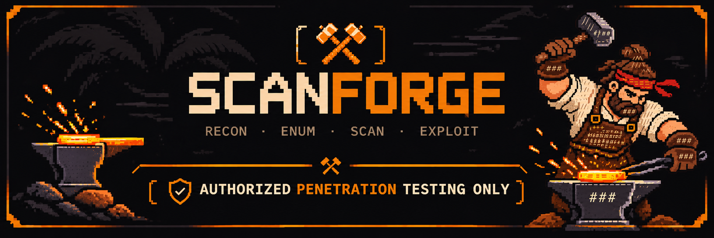
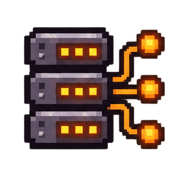
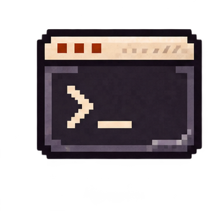
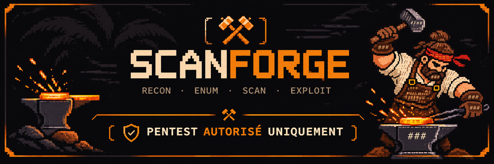

# README（简体中文）

<p align="center">
  
</p>

# ScanForge

> **English**：[英文文档](../../README.md) · **Français**：[法语文档](../fr/README.md)

**ScanForge** 是一款用 Go 编写的命令行工具（CLI），旨在以安全、结构化的方式编排你的渗透测试和侦察（recon）工作流。

借助其以产物（artifact）为驱动的架构，ScanForge 智能地串联业界公认的安全工具，同时实施极其严格的扫描范围（scope）验证规则，防止任何未经授权的扫描。

<p align="center">
  
</p>

##  文档

- [使用指南](USAGE.md)：安装、配置、命令与示例。
- [范围管理](SCOPE.md)：隐式模式、文件、排除项与 CI。
- [架构](ARCHITECTURE.md)：DAG、产物、集中过滤与输出。
- [增量扫描](INCREMENTAL.md)：资产历史与 `--incremental`。
- [递归发现](RECURSIVE.md)：`--recursive`。
- [恢复与检查点](RESUME.md)：中断并恢复运行。
- [工作流](WORKFLOWS.md)：YAML 工作流。
- [MCP 服务器](MCP.md) 与 [本地 API](API.md)：从 AI 代理驱动 ScanForge。
- [贡献指南](../AGENTS.md)：仓库结构、代码风格与验证。

##  核心特性

- **产物驱动的流水线**：模块通过产物有序通信（例如 `subfinder` 的输出自动喂给 `dnsx` 和 `httpx`），每个独立分支会在输入就绪后立即继续执行。
- **严格的扫描范围验证**：通过文件显式指定范围，或确认隐式范围（DNS 域名默认为 `domain`，IP 或显式指定时使用 `exact`），然后对每个产物进行过滤。
- **多目标项目**：`--targets 文件` 可对一个配置文件中的多个目标运行（每行一个，忽略注释与空行）；每个目标都有独立的范围验证、运行目录和报告，单个目标失败不会中断其余目标。
- **交互式向导**：在终端上直接运行 `scanforge run` 会询问缺失的目标和配置文件，而不是报错。
- **代理集成（Caido / Burp Suite）**：`--proxy` 将相关模块的 HTTP 流量路由到你的拦截代理，便于手动分类/重放。
- **认证扫描**：`-H/--header`（可重复）向发出的每个 HTTP 请求注入请求头/ Cookie（会话、Bearer 令牌）。
- **JavaScript 密钥扫描器**：`jssecrets` 模块抓取爬取到的 `.js` 文件，检测泄露的 API 密钥/令牌/凭据、公共云存储桶、内网主机、邮箱、敏感 API 端点以及可访问的 source map；随后 `jsverify` 模块在无头浏览器中重放生成的 PoC 载荷，并报告已执行 / 到达 sink / 未观察到的判定结果。
- **可视化截图**：`screenshot` 模块通过 `httpx` 捕获存活 URL 的截图，并列入报告中。
- **WordPress 对等模式**：`--preset wp`（或在任意预设上加 `--wp`）依次运行 wpdetect（多信号 core 版本）、wpplugins/wpthemes（被动或侵略性枚举）、wpusers（author + REST API）、wpexposure（wp-config 备份、debug.log、目录列表）、wpxmlrpc（方法/multicall/pingback）和 wpcve（漏洞匹配）——覆盖与 wpscan 相同的面，无需新增外部工具。`wpbrute` 仅限可选严格开启（默认关闭）。
- **技术到 CVE 关联**：`techcve` 将检测到的技术与版本与内置数据集匹配，该数据集包含来自 NVD 的真实 CVSS 基础评分。
- **增强的技术到 CVE 关联**：运行 `scanforge intel update` 后，`techcve` 还会使用本地 NVD/CISA KEV/EPSS 缓存；仅当版本落在受影响的 CPE 范围内才会被确认，仅名称相似只是未确认的线索。
- **恢复与检查点**：`scanforge resume <run-id>` 继续被中断的运行，跳过输入相同且已完成的模块；`status` 与 `runs list` 用于查看运行。仅基于文件，无需数据库。
- **YAML 工作流**：`--workflow file.yaml` 定义步骤、依赖、超时、重试与错误策略；执行前校验（`scanforge workflow validate`），无任意 shell，范围过滤保持不变。
- **资源限制**：`--concurrency`、`--rps`、`--max-requests` 和 `--command-timeout`（或配置中的 `limits:`）限制一次运行的激进程度。
- **发现事件（实验性）**：`--events` 将经范围过滤的发现事件（如子域名为 `DNS_NAME`）写入 `00_meta/events.jsonl`。
- **增量扫描**：`--incremental` 将本次运行与每个目标的资产历史（`runs/<target>/assets.jsonl`）比较，使 nuclei、ffuf、katana 和 jssecrets 只处理新增或变化的 URL；`scanforge assets <target> [--new|--gone]` 列出历史。
- **递归发现（可选）**：`--recursive`（配合 `--recursive-depth` / `--recursive-budget`）通过有界的 dnsx/httpx/katana 流程跟进较晚（JS、爬取）发现的范围内新名称与 URL；范围外的发现会被丢弃并记录。
- **非标准 Web 端口**：在 `deep`/`full` 中，`httpx` 还会探测 `naabu` 发现且经范围过滤的 `host:port` 目标（8080、8443、3000 等）。
- **代理访问（MCP + API）**：`scanforge mcp` 与 `scanforge api` 提供运行、资产、发现结果与证据。主动扫描默认关闭，需要 `--allow-active` 加严格的范围文件；每次主动调用都会被审计。目标泄露的密钥在发现结果中保持完整，仅操作者自己的凭据会在日志及 API/MCP 输出中被遮蔽。
- **完全可配置的 Nuclei**：通过专用参数控制严重级别、标签、速率限制、整体超时、自定义模板和模板更新。
- **Nmap 并行化**：有界工作线程池（`--nmap-concurrency`），替代逐主机顺序扫描。
- **实时控制台**：扫描会流式输出按时间排列、带标签的事件日志（无全屏界面）——流水线阶段、模块生命周期、发现结果即时打印（含泄露的邮箱、密钥或主机）、交互式终端上的可变进度行（默认是 生成的像素锤与铁砧动画，16 列 × 6 行，旁边显示进度；终端窄于 50 列时使用单行指示器；`SCANFORGE_SPINNER=forge|dots|off` 可切换）、high/critical 级别发现的展开严重程度块、去重后计入 `Finding types` 汇总的重复项，以及最终的 `── SCAN COMPLETE ──` 汇总。输出对 grep/tee/CI 友好；`-v/-vv/-vvv` 提升详细程度，`-q` 只保留发现项、错误和汇总。
- **Webhook 通知**：每次运行结束时，将摘要发布到 `scanforge.yaml` 中配置的 Slack/Discord/Teams webhook。
- **运行对比与导出**：`scanforge diff` 列出同一目标两次运行之间的变化（资产、端口、漏洞）；`scanforge export` 将运行序列化为 SARIF 2.1.0（GitHub/GitLab 代码扫描）或 DefectDojo 通用发现。
- **Dry-Run 模式**：在发出任何网络请求之前，预览将要执行的命令和生成的文件。
- **诊断工具（Doctor）**：即时检查本地依赖项是否已为所选配置文件安装并配置。
- **合并报告**：自动生成统一的风险模型，输出 `report.json` 和 `report.md` 格式。

---

##  支持的工具

ScanForge 集中编排 **14 个外部安全工具** 和 **14 个内置模块**：

外部工具：

1. **subfinder**（子域名发现）
2. **shuffledns**（DNS 暴力破解，模块 `dnsbrute`；结果合并到 `dnsx`）
3. **dnsx**（主动 DNS 解析）
4. **httpx**（HTTP 探测、技术识别与截图）
5. **naabu**（超快端口扫描器）
6. **nmap**（精确的端口扫描与服务识别，并行执行）
7. **whatweb**（Web 技术指纹识别）
8. **wafw00f**（Web 应用防火墙检测）
9. **katana**（Web 资源爬取）
10. **ffuf**（目录与文件模糊测试）
11. **nuclei**（基于模板的漏洞扫描器）
12. **gau**（被动收集历史 URL）
13. **tlsx**（TLS 证书与协议增强）
14. **chromium**（`jsverify` 模块使用的无头浏览器）

内置模块（无需外部二进制）：

- **jssecrets** —— 分析 `katana` 爬取的 JS，检测密钥、云存储桶、内网主机、邮箱和暴露的 source map
- **jsverify** —— 在无头浏览器中重放 `jssecrets` 的 PoC 载荷（通过 URL 参数、fragment 和 `postMessage` 注入），并报告已执行、到达 sink 或未观察到的判定结果
- **attacksurface** —— 将存活主机、爬取 URL、模糊测试路径和 JS 发现的端点整合为一份攻击面列表，供下游扫描器使用
- **techcve** —— 将检测到的技术与版本与内置数据集中的已知 CVE 关联（来自 NVD 的真实 CVSS 基础评分）
- **httpcheck** —— 在发现的攻击面上检查 HTTP 安全请求头（CSP、HSTS、点击劫持、Cookie）
- **payloadgen** —— 根据扫描发现生成上下文相关词表（API 路径、参数、按技术划分的端点）
- **wpdetect** —— 多信号 WordPress 检测与 core 版本指纹识别（generator、RSS、readme.html、REST 索引）
- **wpplugins** / **wpthemes** —— 被动（爬取资源、`?ver=`）或主动（`readme.txt`/`style.css`、内置热门列表、`--wp-detection-mode`/`--wp-wordlist`）枚举插件/主题
- **wpusers** —— 通过 `?author=N` 重定向和 REST `/wp/v2/users` 端点枚举 WordPress 用户
- **wpexposure** —— 检查 wp-config 备份、debug.log、默认安装页面、目录列表、`.git`/`.env` 暴露
- **wpxmlrpc** —— 探测 XML-RPC：启用状态、方法列表、multicall 和 pingback 可用性
- **wpcve** —— 将 core/插件/主题版本与内置漏洞数据集匹配（离线）
- **wpbrute** —— 针对已枚举用户的可选凭据探测（`--wp-bruteforce` + `--confirm-scope` + `--wp-passwords`；默认关闭）

`httpx`、`nuclei`、`katana`、`ffuf`、`whatweb`、`wafw00f`、`subfinder`、`gau`、`jssecrets`、`jsverify`、`httpcheck` 和 `screenshot` 支持 `--proxy` 和 `-H/--header`，可将流量路由到 Caido/Burp 并以认证模式扫描。

---

##  简单安装（省心）

与主流工具（nuclei、subfinder 等）一样，ScanForge 通过 GitHub Releases 分发**预编译二进制文件**：无需编译，无需 Go。

### 方式 1：一行命令（推荐）

**Linux / macOS / Git-Bash：**

```bash
curl -fsSL https://raw.githubusercontent.com/MikeRoss27/scanforge/main/install.sh | bash
```

该脚本会检测你的操作系统/架构，下载最新版本，校验 SHA-256 校验和，并安装到 `~/.local/bin`。

**Windows（PowerShell）：**

```powershell
Invoke-Expression (Invoke-RestMethod https://raw.githubusercontent.com/MikeRoss27/scanforge/main/install.ps1)
```

安装程序将二进制放在 `%LOCALAPPDATA%\Programs\scanforge`，并自动将目录添加到用户 PATH。

**指定版本或自定义目录：**

```bash
curl -fsSL https://raw.githubusercontent.com/MikeRoss27/scanforge/main/install.sh | bash -s -- --version v0.1.0 --dir /usr/local/bin
```

### 方式 2：完整安装（二进制 + 扫描工具）

ScanForge 编排外部工具（nmap、nuclei、subfinder、httpx 等）。`--full` 会安装具备可靠非交互安装方式的依赖（Debian/Ubuntu 和 Windows 仍需预先安装较新的 Go）：

```bash
curl -fsSL https://raw.githubusercontent.com/MikeRoss27/scanforge/main/install.sh | bash -s -- --full
```

在仓库克隆目录下，本地脚本可完成相同操作：

```bash
chmod +x install.sh && ./install.sh --full   # Linux / macOS
.\install.ps1 -Full                           # Windows (PowerShell)
```

- Arch 仅从官方仓库安装 `nmap`、`chromium`、`go`、`python-pipx` 和 `base-devel`，且绝不运行 `pacman -Syu`。Go 工具使用固定版本，`wafw00f` 通过 pipx 隔离安装，massdns 与 DNS 字典来自经过 SHA-256 验证的上游文件。WhatWeb 仍需手动或通过 AUR 安装，脚本不假设存在 AUR helper。
- Debian/Ubuntu 只安装当前 apt 版本中存在的软件包，且不会通过全局 pip 修改系统 Python。
- macOS 使用 Homebrew、Go 和 pipx；WhatWeb 与 Chrome/Chromium 浏览器可能仍需手动安装。
- 原生 Windows 上的 Nmap、massdns 和 WhatWeb 仍需手动安装；需要这些工具时建议使用 WSL 或 Docker。

最终检查会列出所有缺失项，`scanforge doctor --profile NAME` 会给出按 profile 区分的状态和安装提示。

### 方式 3：Docker（零本地安装）

如果你不想在宿主机上安装 Go 或其他工具，可以使用 Docker。镜像包含运行时工具、massdns、Chromium 以及固定版本并经过验证的 DNS 字典。

```bash
# 使用 docker-compose
docker-compose run scanforge run target.com --profile web

# 手动使用 Docker
docker build -t scanforge .
docker run -v $(pwd):/workspace scanforge run target.com --profile web
```

---

##  从源码构建（开发）

克隆仓库后，`Makefile` 封装了 Go 工具链：

```bash
make build      # 使用版本 ldflags 构建 ./scanforge
make install    # 同上，安装到 $GOPATH/bin
```

常用开发目标：

| 命令 | 作用 |
| --- | --- |
| `make dev` / `make run` | 通过 `go run` 运行 CLI，无需构建；用 `ARGS="plan example.com --preset deep"` 传参 |
| `make test` / `make race` | 测试套件（快速 / 带竞态检测） |
| `make check` | 推送前检查：格式检查、`go vet`、golangci-lint 和测试 |
| `make cover` | 带覆盖率报告的测试及按函数汇总 |
| `make fmt` / `make fmt-check` | 格式化代码 / 仅列出未格式化的文件而不改写 |
| `make vet` / `make lint` | 静态分析；`make tools` 安装 CI 固定版本的 golangci-lint |
| `make tidy` | 清理 `go.mod` / `go.sum` |
| `make clean` | 删除二进制文件和 `coverage.out` |

---

##  快速入门指南

### 1. 初始化项目

在当前目录生成默认配置文件：

```bash
scanforge init
```

这将创建：

- `scanforge.yaml`：配置工具路径以及修改/定义配置文件。
- `scope.txt`：可选模板，用于保留可复用的测试范围。你可以删除它；ScanForge 随后会提出一个需要确认的最小隐式范围。

### 2. 验证环境

检查扫描配置文件所需的所有工具是否已安装并可访问：

```bash
scanforge doctor --profile web
```

### 3. 启动扫描

在没有适用的范围文件时，ScanForge 默认包含所提供的 DNS 域名及其子域名，显示范围并在创建运行前请求确认。发现的子域名会自动传递给 DNSX、HTTPX 和后续模块。IP 和单标签主机名仍使用精确范围：

```bash
scanforge run example.com --profile web
```

在终端上，直接运行 `scanforge run`（不带目标和配置文件）会打开一个交互式向导，询问两者。使用 `--scope-mode exact` 可将运行限制为所提供的主机。添加规则或排除主机：

```bash
scanforge run example.com --scope-mode domain \
  --scope-add api.other.test --exclude admin.example.com
```

`--scope file.txt` 保持最高优先级，如果它拒绝目标，绝不会被静默替换。为避免歧义，它不能与 `--scope-mode`、`--scope-add` 或 `--exclude` 组合使用。显式或配置的文件无需额外确认。在 CI 或无 TTY 的情况下使用隐式范围时，请先检查 `scanforge plan`，然后用 `--confirm-scope` 确认意图。

在不发送任何请求的情况下进行测试：

```bash
scanforge run example.com --profile web --dry-run --confirm-scope
```

使用隐式范围时，dry-run 同样需要确认：它不会执行网络请求，但会正式确定授权的范围。

在创建运行前预览已验证的流水线：

```bash
scanforge plan example.com --preset deep
```

`scanforge scan` 命令是 `scanforge run` 更直接的别名：

```bash
scanforge scan example.com --preset safe
```

### 4. 多目标项目

`run` 和 `plan` 接受目标文件，而不是单个位置参数目标：

```bash
scanforge plan --targets targets.txt --preset web
scanforge run --targets targets.txt --preset web --confirm-scope
```

文件每行一个目标（忽略 `#` 注释和空行）。`--targets` 与位置参数目标互斥。

### 5. 对比运行与导出发现

`scanforge diff` 重新整合两个运行目录，并列出变化内容 —— 出现或消失的资产、端口和漏洞：

```bash
scanforge diff runs/example.com/2026-08-09_10-00-00 runs/example.com/2026-08-10_10-00-00
scanforge diff runs/example.com/2026-08-09_10-00-00 runs/example.com/2026-08-10_10-00-00 --json
```

`scanforge export` 将整合后的报告序列化为第三方工具可用的格式：

```bash
scanforge export runs/example.com/2026-08-10_10-00-00 --format sarif          # GitHub/GitLab 代码扫描
scanforge export runs/example.com/2026-08-10_10-00-00 --format defectdojo     # import-scan "Generic Findings Import"
```

### 6. API 密钥与更新

某些工具（subfinder、nuclei 等）受益于 API 密钥。使用 `scanforge auth` 管理它们：

```bash
scanforge auth set shodan <API_KEY>
scanforge auth list
scanforge auth sync
```

使用 `scanforge update` 更新二进制文件（以及可选的外部工具）：

```bash
scanforge update            # 仅二进制（需要 Go）
scanforge update --tools    # 二进制 + 外部工具
```

---

##  代理、认证与 Nuclei 设置

在真实渗透测试中，将流量路由到 Caido（或 Burp Suite）并注入已认证的会话：

```bash
scanforge run app.example.com --profile web \
  --proxy http://127.0.0.1:8080 \
  -H "Cookie: session=..." \
  --nuclei-tags cve,exposure --nuclei-severity critical,high \
  --nuclei-update-templates \
  --nuclei-include-custom \
  --ffuf-wordlist /usr/share/wordlists/dirb/big.txt \
  --nmap-concurrency 6
```

- `--proxy`：为使用 HTTP 的模块指定 HTTP/SOCKS 代理。
- `-H/--header`（可重复）：添加到每个请求的原始请求头 `"名称: 值"`。
- `--nuclei-severity`、`--nuclei-exclude-severity`、`--nuclei-tags`、`--nuclei-exclude-tags`、`--nuclei-rate-limit`、`--nuclei-templates`、`--nuclei-update-templates`：精细控制漏洞扫描器。
- `--nuclei-timeout`：nuclei 运行的整体时间限制，例如 `45m`（默认 30m；对于慢速代理或大型目标列表请调高）。
- `--nuclei-headless`：启用 nuclei 无头模式（基于浏览器的模板）。
- `--nuclei-include-custom`：同时运行 `templates/` 中捆绑的 40+ 个 ScanForge 模板（云元数据端点、暴露的管理面板和仪表盘、CORS 错误配置、XXE、SSRF、调试端点等）；通过 `SCANFORGE_TEMPLATES_DIR`、`./templates` 或二进制文件所在目录定位。
- `--ffuf-wordlist`、`--ffuf-filter-codes`：覆盖 ffuf 词表（默认 `/usr/share/wordlists/dirb/common.txt`）并过滤状态码。
- `--nmap-concurrency`：并行的 nmap 扫描数（默认 4）；在敏感项目上请调低以保持低调。

### Webhook 通知

在 `scanforge.yaml` 中设置 `webhook.url`，即可在每次扫描结束时在 Slack、Discord 或 Teams 上收到运行摘要：

```yaml
webhook:
  url: https://example.com/hooks/your-webhook-url
```

载荷是带有 `text` 字段的通用 JSON 文档，因此每个主流 webhook 接收器都会显示可读消息（目标、配置文件、状态、资产、端口、按严重级别划分的漏洞、运行目录）。

---

##  内置配置文件与预设

| 名称 | 模块 | 用途 |
| --- | --- | --- |
| `safe` | subfinder, dnsx, httpx, tlsx | 轻量暴露面检查。 |
| `recon` | subfinder, dnsbrute, gau, dnsx, httpx, tlsx | 用历史 URL 和 DNS 暴力破解丰富资产清单。 |
| `passive` | subfinder, dnsx, httpx | 最小历史流水线。 |
| `ports` | subfinder, dnsx, naabu, nmap | 开放端口，然后验证服务。 |
| `web` | subfinder, dnsbrute, dnsx, httpx, whatweb, wafw00f, katana, jssecrets, jsverify, attacksurface, techcve, httpcheck, payloadgen, screenshot, nuclei | 应用分析：攻击面整合、JS 密钥 + 无头验证、截图、技术到 CVE 关联、请求头检查与载荷生成。 |
| `vuln` | subfinder, dnsbrute, dnsx, httpx, tlsx, katana, jssecrets, attacksurface, techcve, nuclei | 针对性漏洞检测（技术到 CVE + 模板）。 |
| `deep` | 所有模块 | 完整且高噪音的流水线。 |
| `full` | 所有模块 | 完整配置文件，兼容历史版本。 |
| `wp` | subfinder, dnsbrute, dnsx, httpx, whatweb, wpdetect, wpplugins, wpthemes, wpusers, wpexposure, wpxmlrpc, wpcve, techcve, httpcheck, attacksurface, nuclei, screenshot | WordPress 渗透链：检测、插件/主题枚举、用户映射、暴露面检查、XML-RPC 与漏洞匹配。别名 `wordpress`。`--wp` 可叠加到任意预设。`wpbrute` 仅限可选开启（`--wp-bruteforce` + `--confirm-scope` + `--wp-passwords`）。 |

`--preset safe` 和 `--profile safe` 可互换使用。在任何活动配置文件之前，请始终用 `scanforge plan` 检查其 DAG。

---

##  最终报告结构

每次扫描结束后，会在 `./runs/` 下创建带时间戳的文件夹。除每个工具的原始日志外，ScanForge 还会生成：

- `report.json`：资产、端口、技术和漏洞的结构化模型。
- `report.md`：可读的简明报告。
- `00_meta/manifest.json`：运行状态、模块、产物和范围元数据。
- `00_meta/commands.log`：准备或执行的外部命令。
- `00_meta/effective-scope.txt`：实际应用范围的规范副本，其来源和模式记录在清单中。
- `00_meta/scope-rejections.jsonl`：被拒绝的范围外值（如有）。
- `04_surface/attack-surface.txt`：供扫描器使用的整合候选 URL（`attacksurface` 模块）。
- `04_payloads/`：为 API 路径、端点、参数和按技术划分的端点生成的词表（`payloadgen` 模块）。
- `04_web/screenshots/`：存活 URL 的 PNG 截图（`screenshot` 模块）。
- `06_vulns/js-secrets.jsonl`：在爬取的 JS 中检测到的密钥、云存储桶、内网主机、邮箱和 source map（`jssecrets` 模块）。
- `06_vulns/js-payloads.txt`：根据 JS 密钥生成的 PoC 载荷（`jssecrets` 模块）。
- `06_vulns/js-verified.jsonl`：JS 载荷的无头浏览器判定结果（已执行、到达 sink、未观察到）（`jsverify` 模块）。
- `06_vulns/cve-findings.jsonl`：根据指纹关联的易受攻击版本（`techcve` 模块）。
- `06_vulns/http-checks.jsonl`：缺失的安全请求头和 Cookie 标志（`httpcheck` 模块）。
- `06_vulns/nuclei.jsonl`：nuclei 原始发现（`nuclei` 模块）。

>  ScanForge 只能用于你拥有明确授权的资产。

<p align="center">
  
</p>
